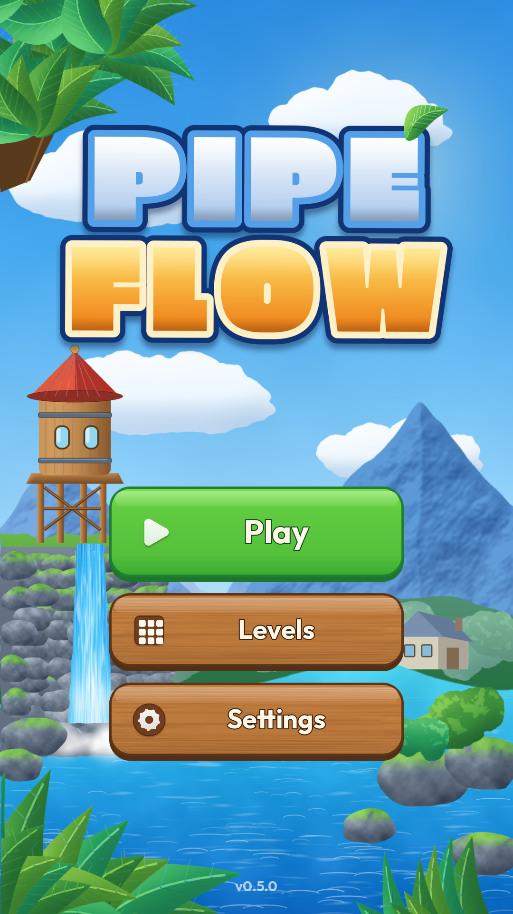
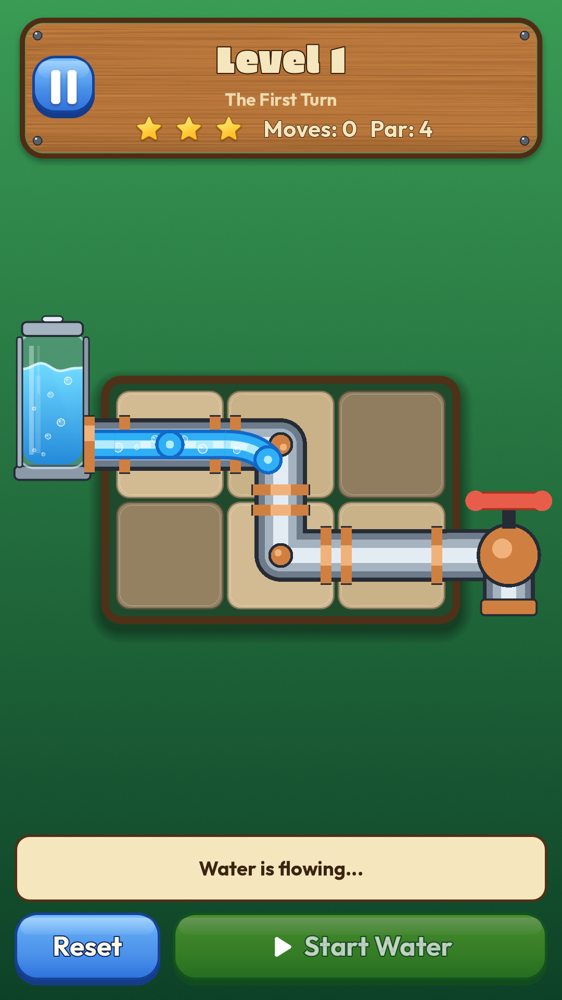
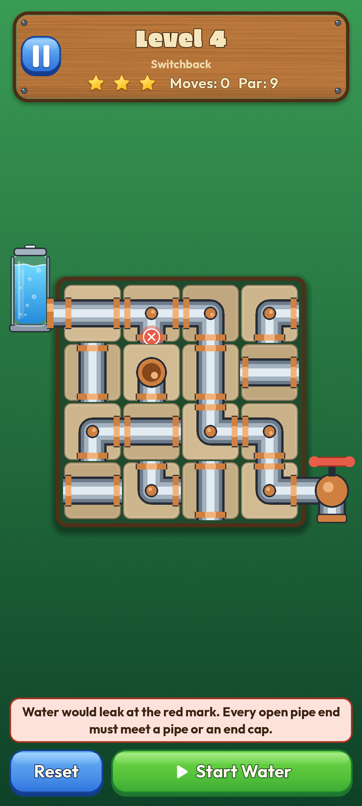

# Pipe Flow

**A portrait-first pipe-connection puzzle game built with Godot.**

Pipe Flow asks players to rotate pipe segments to connect a full water tank to a tap. Every pipe reached by the flow must also be sealed: an open branch is a leak even when the tap is reachable. The v0.5.0 project includes a 20-level campaign, an animated water timeline, a pause/settings flow, progress and star scoring, plus an Android debug build.

**[Download the Android APK](https://github.com/maxew6/pipe-flow-godot/releases/latest/download/pipeflow-v0.5.0-debug.apk)** · [View v0.5.0 release notes](https://github.com/maxew6/pipe-flow-godot/releases/tag/v0.5.0) · [Build and verification report](docs/BUILD_REPORT.md)

## Screenshots

Captured from the real Godot scenes at the labelled portrait resolutions. The repository includes all 22 full-resolution captures and the water-flow timeline.

| Main menu | Water in motion | Sealed-network leak feedback |
|:--:|:--:|:--:|
|  |  |  |

More screenshots: [1080×1920](docs/screenshots/1080x1920/) · [1080×2400](docs/screenshots/1080x2400/) · [screenshot index](docs/screenshots/SCREENSHOT_INDEX.md)

## Project highlights

- **Sealed-network flow validation:** success requires reaching the tap without any reachable open pipe end leaking into an empty cell, the board edge, or a closed connection.
- **Pure core logic:** connectivity, flow solving, progression and scoring are separated from Godot nodes and autoloads.
- **Animated feedback:** water advances through the board over time, draining the tank, filling pipes and operating the tap; blocked routes identify the first leak.
- **Portrait-friendly interface:** level selection, gameplay, pause/settings, completion, and water states are captured at two phone-like resolutions.
- **Android export:** portrait ARM64 debug APK for `com.pipeflow.game`, signed for sideloading.

## Verification snapshot

- Godot automated suite: **506 passed, 0 failed**.
- Sealed-network solver mirror: all **20** stored solutions are valid and leak-free; negative cases cover reachable branches, misoriented caps, empty cells, board edges and cycles.
- Real-scene proof: **11 states at each of 1080×1920 and 1080×2400**, including a route that reaches the tap but is correctly rejected for a leak.
- Android APK signature and manifest verified. Device installation was not available in the build environment; see the [build report](docs/BUILD_REPORT.md) for limits and tool versions.

## Run and test the project

Open the repository root (`project.godot`) in Godot **4.7.2** or run it from a terminal:

```bash
godot --path .
```

Run the automated Godot checks and the pure-Python solver mirror:

```bash
godot --headless --path . --script res://tests/test_runner.gd
python3 tools/verify/solver_mirror.py
```

For an Android export, install matching Godot export templates and the Android SDK, configure your own debug keystore in the Android export preset, then export the `Android` preset:

```bash
godot --headless --path . --export-debug Android build/pipeflow-v0.5.0-debug.apk
```

The published APK is a debug build for installation on compatible ARM64 Android devices. Android may require enabling **Install unknown apps** for the app you use to open the APK. The APK has not been tested on a physical phone or emulator.

## Technical details

- **Engine:** Godot 4.7.2, GDScript, Mobile renderer
- **Android:** portrait; min SDK 24; target SDK 36; ARM64; VIBRATE permission
- **Version:** 0.5.0 (version code 50)
- **Package:** `com.pipeflow.game`

## Repository layout

- `project.godot`, `scenes/`, `scripts/`, `data/`, `assets/` — Godot project
- `scripts/core/` — engine-independent puzzle and flow logic
- `tests/` and `tools/verify/` — regression suite, solver mirror and real-scene proof harness
- `docs/screenshots/` — 22 full-resolution real-scene captures
- `docs/verification/` — build, test, solver and screenshot-harness logs
- `docs/BUILD_REPORT.md` — source changes, APK metadata, toolchain and limitations

Created by **Mahesh Konda** as a Godot game project. The release APK is provided as a debug-signed proof build, not a Play Store release.
